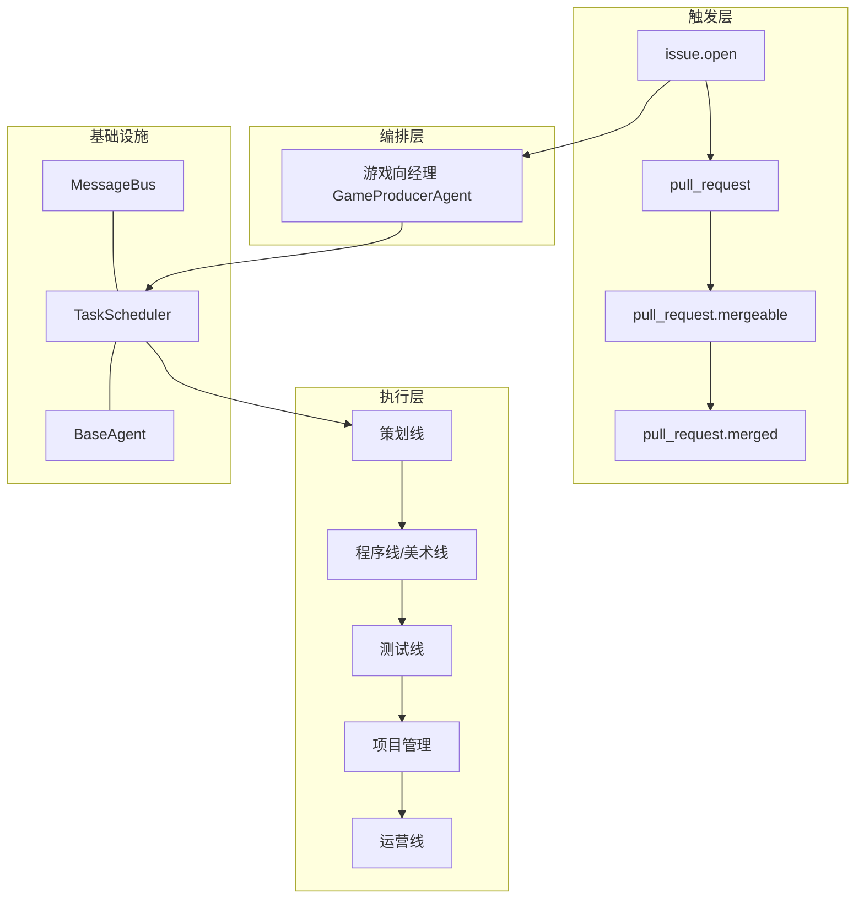

# 游戏向经理 Agent 系统化改进（借鉴架构师 Agent 方法论）

> 本文件由 `dongdongxiaozu/dongjiagoushi`（架构师 Agent）的「架构八步方法论 +
> 安全护栏 + 接力/回转/打断协议 + 测试信号灯」驱动，对本仓库"游戏向经理 Agent +
> 机制驱动编排"做一次系统性的研究与改进落地。

## 一、为什么借鉴架构师 Agent

跨库调研 `dongjiagoushi`（[公开](https://cnb.cool/dongdongxiaozu/dongjiagoushi)）发现，
其沉淀了一套成熟的架构工程化方法论，与本仓库"机制驱动、非手动推进"理念高度契合，可直接迁移强化：

| 架构师实践 | 本项目现状 | 改进价值 |
|-----------|-----------|---------|
| **架构八步方法论**（调研→拓扑→可行性→工程方案→分工→进度→索引→复盘） | 缺系统化的架构闭环 | 让每轮迭代有可核验交付物与留痕 |
| **CP1/CP2/CP3 暂停确认点** | 打回仅靠 `changes_requested` 事件 | 引入人类审批门禁，防止误合并 |
| **回转/打断协议** | 打回只阻塞不返工 | 支持 `[回转]` 打回重做、`[打断]` 断点续跑 |
| **测试信号灯（护栏）** | 无自动化验收断言 | 未真正跑通即红灯阻塞，防"半成品" |
| **Issue 模块版本管理** | 无模块能力演进线 | 支持模块阶段性多次加强 |
| **接力卡 / 三层触发** | 部门协作无强制触发 | 协作角色被硬约束而非靠自觉 |

## 二、八步方法论落地方案

### 2/8 顶层架构拓扑（本仓库现状）

### 3/8 可行性验证结论

- **消息总线 + 调度器 + Agent 内核**：已可运行，评审 Bug 已修复（架构蓝图消费、打回阻塞、状态机告警）。
- **自动合并门禁**：已在 `pull_request.mergeable` 增加评审门禁 NPC 校验，避免与评审/打回竞争。
- **测试信号灯**：新增 `tests/test_producer_agent.sh`，对关键修复做静态/功能断言。

### 4/8 工程实施方案（本 PR 已落地）

| 改进项 | 落点 | 说明 |
|-------|------|------|
| 架构蓝图消费修复 | `game_producer_agent.py` | `build_task_assign` 入参在 `content['inputs']['architecture']`，修正读取路径并补断言 |
| 打回真正阻塞 | `game_producer_agent.py` | 打回时 `queue.block` 阻塞下游（不再产生 FAILED 瞬时态）并另发返工通知 |
| 业务状态机可观测 | `game_producer_agent.py` | `ACCEPT`/`TRACK_DEPS` 保留为终态，不再被 `IDLE` 覆盖 |
| 部门角色对齐 roles.yaml | `game_producer_agent.py` | `DEPARTMENTS` 从 `roles.yaml` 动态解析，默认岗位对齐 `producer`，排除经理自派单 |
| 心跳督导落地 | `game_producer_agent.py` | 定期扫描 `BLOCKED`/逾期工作包并督导相关部门 |
| 自动合并门禁 | `.cnb.yml` | `pull_request.mergeable` 前增加评审门禁 NPC 校验 |
| 状态机告警修复 | `agent_core.py` | `ANALYZING -> IDLE` 补入 `DEFAULT_TRANSITIONS` |
| 镜像锚点复用 | `.cnb.yml` | `npc:go` 阶段共用 YAML 锚点镜像，一处修改全局生效 |
| 测试信号灯 | `tests/test_producer_agent.sh` | 12 项断言覆盖关键修复与新增特性 |

### 5/8 分工与协作规则（改进方向）

- **回转协议**：部门产出打回后，经理把返工任务以 `[回转]` 重新派发给原部门，形成"打回 → 返工 → 重验"闭环，而非只阻塞。
- **接力卡**：部门工作包携带"任务书 + 输入上下文 + 输出契约"，保证跨角色无痕接手。
- **三层强制触发**：协作角色由显式声明 / 语义向量 / AGENTS.md 规则兜底触发，非纸面说明。

### 6/8 进度对齐（路线图）

| 阶段 | 内容 | 状态 |
|------|------|------|
| v0.5 | 游戏向经理：架构拆解 + 部门分工协作 | ✅ |
| v0.6 | 机制驱动自动化流水线（.cnb.yml 事件驱动） | ✅ |
| v0.6.1 | 评审修复 + 合并门禁 + 测试信号灯 | ✅ 本 PR |
| v0.6.2 | 打回仅阻塞+返工通知、状态终态可观测、岗位对齐 roles.yaml、心跳督导 | ✅ 本 PR |
| v0.6.3 | **修复依赖解锁核心机制**、API 鉴权+本地绑定、岗位去 `_alt` 变体、DDL 逾期督导落地 | ✅ 本 PR |
| v0.7 | 多部门 Agent 端到端联动跑通全流程 | 🔜 |
| v0.8 | 接入回转/打断协议 + 经验记忆库 | 🔜 |

### 7/8 索引建立

- 关键代码：`game_producer_agent.py` / `agent_core.py` / `message_bus.py` / `task_scheduler.py`
- 流水线：`.cnb.yml` / `.cnb/settings.yml`
- 测试：`tests/test_producer_agent.sh`
- 文档：本文件 + `game-orchestration.md`

### 8/8 汇报与复盘

**本次改进**：修复 1 个关键功能 Bug + 2 个一致性/编排问题，引入"测试信号灯"与"合并门禁"两道机器护栏，
并验证跨库借用架构师方法论在本仓库可落地、可复用。

**第二轮评审改进（v0.6.2）**：
- 打回分支改为**仅 `block`**（不再先 `on_fail`，消除 FAILED 瞬时态与 `task_failed` 通知误导），并**另发返工通知**引导部门重做；
- 业务状态机保留 **`ACCEPT`/`TRACK_DEPS` 终态**（不再被 `IDLE` 覆盖），`report()` 可真实反映最近一次验收结果；
- `DEPARTMENTS` 改为**从 `roles.yaml` 动态解析**，默认岗位对齐 `producer`，并排除经理自派单，消除与架构约束的偏离；
- 落地 **`heartbeat()`**：定期扫描阻塞/逾期工作包并督导，取代空实现；
- `.cnb.yml` 的 `npc:go` 镜像改为 **YAML 锚点复用**，一处修改全局生效。

**第三轮评审改进（v0.6.3，核心机制修复）**：
- **修复依赖解锁核心 Bug（critical）**：`_dispatch` 创建的 `Task` 此前用默认 UUID id（`task_xxx`），而 `_split_work_packages` 填写的 `depends_on` 是工作包 id（`wp_xxx`），调度器按**任务 id**解析依赖导致上游验收后下游永不解锁。修复为 `Task(id=wp["id"])` 对齐 id，并补测试断言「上游完成→下游解锁重派发」，此 Bug 现已被 CI 拦截；
- **接口层安全加固**：`/ai/*` 与 `/dashboard/*` 增加可选 **Bearer Token 鉴权**（`API_TOKEN` 环境变量），默认绑定 `127.0.0.1`（`HOST` 可显式跨机），避免工作包/风险/事件信息泄露；
- **岗位去 `_alt` 变体**：`_load_departments` 过滤 `_alt` 后缀角色，避免多态变体被当协办重复派单；且改为**实例属性**，杜绝改写模块级全局 `DEPARTMENTS` 的跨实例污染；
- **DDL 逾期督导落地**：`_assign_resources` 为工作包设基线 DDL，heartbeat 的「逾期督导」分支不再因任务无 DDL 而成为死代码；
- **`accepted` 去重**：同一产出重复验收不再产生重复 id。

**风险与待办**：
1. 部门 Agent 目前多为框架级实现，端到端真实协作（v0.7）尚未跑通；
2. `[回转]`/`[打断]` 协议、经验记忆库（v0.8）为下一阶段演进项；
3. `.cnb.yml` 使用 `default-npc:latest`，生产环境建议固定镜像版本（可用锚点统一改一处）。

> 借鉴来源：`dongdongxiaozu/dongjiagoushi` 的 `架构八步方法论`、`测试信号灯`、`回转/打断协议`、`Issue 版本管理`。
